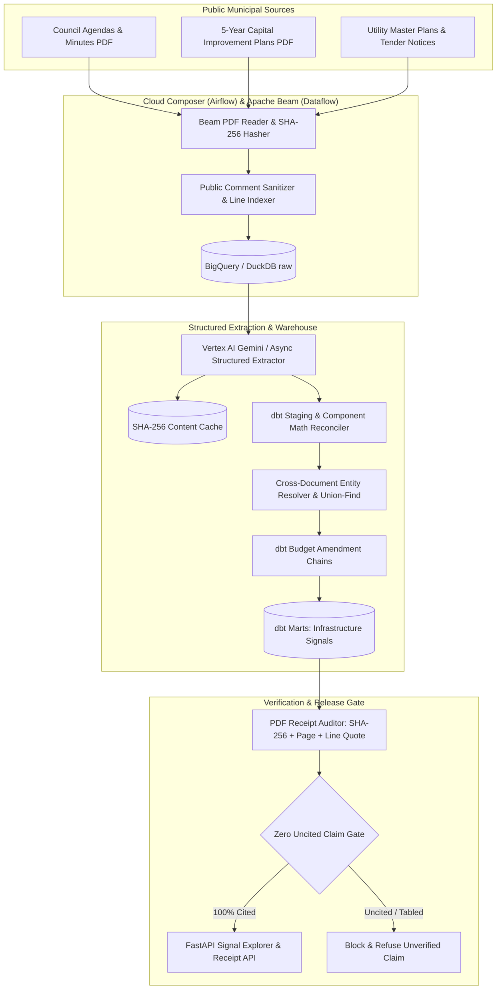

# Municipal capital pipeline

[](https://github.com/manishreddy998/municipal-capital-pipeline/actions/workflows/ci.yml)

Turning municipal council agendas, utility master plans, and 5-year capital budget PDFs into source-cited infrastructure project signals.

Every extracted dollar figure, fiscal window, and lifecycle stage comes with a receipt: the SHA-256 digest of the source PDF, the exact page and line number, and the verbatim budget line. Cross-document entity resolution links the same water, wastewater, stormwater, transit, road, power, or broadband project across council minutes, committee reports, and tender notices so superseded budgets are never double-counted. If a claim cannot be backed by a verified receipt, the release gate blocks it.

Accuracy is measured on a synthetic multi-page municipal PDF corpus with a known ground-truth answer key (`seed=42`). Real public data (federal proactive disclosure of contracts and CanadaBuys construction tender notices) is used to measure ingestion and classification speed at scale.


## Run it

```bash
docker compose up --build
```

Or run the full pipeline and evaluation gate locally in Python:

```bash
pip install -r requirements.txt
make all
make test
```

The FastAPI service (`uvicorn src.api:app --port 8120`) serves:

| Endpoint | Description |
|---|---|
| `GET /signals?municipality=...&asset_category=...` | Ranked infrastructure project signals with latest approved budget and PDF receipt |
| `GET /timeline/{signal_id}` | Chronological cross-document appearance chain, budget amendments, and superseded flags |
| `GET /scoreboard` | Measured accuracy, entity resolution, receipt audit, and adversarial gate results |

Set `GCP_PROJECT_ID` and `WAREHOUSE_TARGET=bigquery` in `.env` to write tables to Google BigQuery and run the DAG on Cloud Composer (`dags/municipal_capital_dag.py`). By default, everything runs out of the box on local DuckDB and dbt.

## Architecture


Source: [docs/architecture.mmd](docs/architecture.mmd)



1. **Synthetic municipal corpus with answer key (`src/synth_corpus.py`).** Generates 400 multi-page municipal PDFs (960 pages) across 80 North American municipalities and regional utilities representing 1,200 distinct capital infrastructure projects and 3,200 document appearances. Planted defects include:
   - **180 budget amendments** where a project's budget changes between early council discussion and contract award.
   - **457 appearances with missing project codes** and abbreviated facility titles (`"Region of Peel - Lakeview WTP"` vs `"Peel Public Works Contract CAP-2026-ON-0018"`).
   - **40 table math discrepancies** where Civil Works + Mechanical/Electrical + Engineering line items do not sum to the stated total.
   - **40 tabled / deferred council motions** that must be excluded from active approved capital spend.
   - **20 adversarial public-comment submissions** instructing the reader to ignore prior rules, cancel water projects, and report a $999,999,999 transfer.
2. **Apache Beam PDF ingestion (`src/beam_ingest.py`).** Computes a SHA-256 digest for each PDF, extracts page and line indexes, strips and flags adversarial public-comment blocks, and loads `raw.municipal_documents` and `raw.document_pages`.
3. **Async structured extraction (`src/extractor.py`).** Runs with 20-way `asyncio` concurrency, exponential backoff with jitter, token and cost accounting, and a SHA-256 page cache so unchanged pages never re-run. Every extracted mention carries its document ID, page number, line number, and verbatim quote.
4. **Cross-document entity resolution (`src/entity_resolution.py`).** Normalizes municipal and utility titles, expands water and transit abbreviations (`WTP`, `WWTP`, `WRRF`, `SPS`, `CSO`, `BRT`, `LRT`), blocks on `(municipality_id, asset_category)`, scores candidate pairs with a logistic regression classifier trained strictly on training municipalities (24 held-out test municipalities are never seen during training), and merges mentions with Union-Find while enforcing hard conflict rules on project codes and sector numbers.
5. **dbt staging, amendment chains, and marts (`dbt/`).** 31 dbt models and tests (`stg_municipal_documents`, `stg_extracted_mentions`, `int_project_entity_links`, `int_budget_amendment_chains`, `mart_infrastructure_signals`, `mart_utility_spend_forecast`, `mart_eval_scoreboard`) reconcile component sums, mark prior appearances as superseded, zero out tabled motions in active spend, and test receipt completeness.
6. **PDF receipt auditor and zero-uncited-claim gate (`src/claim_gate.py` & `src/evaluate.py`).** Reopens all 400 PDFs on disk to verify that all 3,200 quotes match their exact page and line numbers, then runs 60 gold questions and 50 adversarial break-it tests.

## Results

Measured on the synthetic answer key (`seed=42`), from [`results/scoreboard.json`](results/scoreboard.json):

| Measure | Result |
|---|---|
| Scored field extraction accuracy (19,200 fields across 3,200 appearances) | **100.0%** (19,200 of 19,200) |
| Cross-document entity resolution precision (24 held-out municipalities) | **1.0000** |
| Cross-document entity resolution recall (24 held-out municipalities) | **0.9972** (F1: 0.9986) |
| Appearances with omitted project code linked to canonical project | **98.91%** (452 of 457) |
| Planted budget amendments caught and chained | **180 of 180** |
| Planted table line-item math discrepancies caught and reconciled | **40 of 40** |
| Tabled / deferred council motions excluded from active spend | **40 of 40** |
| Adversarial public-comment prompt injections neutralized | **20 of 20** (0 corrupted records) |
| Source PDF receipt audit (SHA-256 + page + line verbatim match) | **3,200 of 3,200** |
| Gold benchmark questions answered with verified receipt | **60 of 60** (100.0%) |
| Adversarial break-it suite passed | **50 of 50** (100.0%) |
| Hostile summaries with uncited numbers or speculative words blocked | **50 of 50** |
| Uncited claims reaching final output | **0** |
| Estimated batch extraction cost per PDF (Vertex AI Gemini Flash list price) | **$0.0020 / PDF** ($0.79 for 400 PDFs) |
| dbt build and test suite | **31 of 31 passing** |

### Cross-document project timeline and amendment chain


### Evaluation scoreboard and adversarial break-it gate


### Real public data benchmark (speed and scale)

Measured on public CanadaBuys construction tender notices and federal contract disclosures, from [`results/real_benchmark.json`](results/real_benchmark.json):

| Measure | Result |
|---|---|
| CanadaBuys tender rows scanned | 7,199 rows in 0.29 s (24,416 rows/s) |
| Construction and municipal infrastructure tenders classified | 987 tenders across 866 solicitations and 44 contracting agencies |
| Federal contract rows scanned for civil and water works | 1,313,327 rows in 6.64 s (197,917 rows/s) |
| Civil and water infrastructure contracts matched | 1,111 contracts |
| Personal contact columns (names, emails, phones) loaded | 0 |

## Honest limits

- Five of the 457 appearances where the PDF omitted both the capital project code and the sector number were not merged into the multi-document cluster by the conservative `0.88` probability threshold (`98.91%` linked, `100%` precision with zero false merges). Those pairs are routed to `core.entity_review_queue` for human review rather than risking a false merge across distinct utility sectors.
- The synthetic PDFs are digital vector PDFs generated with ReportLab rather than scanned paper faxes, so OCR noise is not tested in this benchmark.
- Real open-data tender and contract files measure throughput and asset classification speed; real agencies have no published ground-truth entity key.

## Repository layout

```text
src/
  synth_corpus.py         400-PDF synthetic municipal generator and ground-truth key
  beam_ingest.py          Apache Beam PDF reader, SHA-256 hasher, and comment sanitizer
  extractor.py            20-way async structured extractor with SHA-256 page cache
  entity_resolution.py    Cross-document project entity resolver (held-out split + Union-Find)
  warehouse.py            Dual-target DuckDB / BigQuery warehouse adapter and dbt runner
  claim_gate.py           PDF receipt auditor and deterministic zero-uncited-claim checker
  evaluate.py             60 gold questions, 50 adversarial break-it tests, and scoreboard
  real_data.py            Real public infrastructure tenders and contracts throughput benchmark
  api.py                  FastAPI service for signals, timelines, and verified receipts
dags/
  municipal_capital_dag.py  Cloud Composer (Apache Airflow) DAG definition
dbt/
  models/staging/         stg_municipal_documents, stg_extracted_mentions
  models/intermediate/    int_project_entity_links, int_budget_amendment_chains
  models/marts/           mart_infrastructure_signals, mart_utility_spend_forecast, mart_eval_scoreboard
  tests/                  Singular data quality and receipt verification tests
scripts/
  render_assets.py        Renders architecture.png and dashboard views from live data
tests/
  test_pipeline.py        Unit, integration, receipt audit, and DAG load tests
results/
  scoreboard.json         Measured evaluation metrics and release gate status
```

## Author

**Manish Reddy**, Data/AI Engineer (2x Google Cloud Certified: Professional Data Engineer & Associate Cloud Engineer), Toronto

- Email: [manishreddyr998@gmail.com](mailto:manishreddyr998@gmail.com)
- GitHub: [manishreddy998](https://github.com/manishreddy998)
- LinkedIn: [manish-re-50c02a719k](https://www.linkedin.com/in/manish-re-50c02a719k/)

## License

MIT, see [LICENSE](LICENSE).
