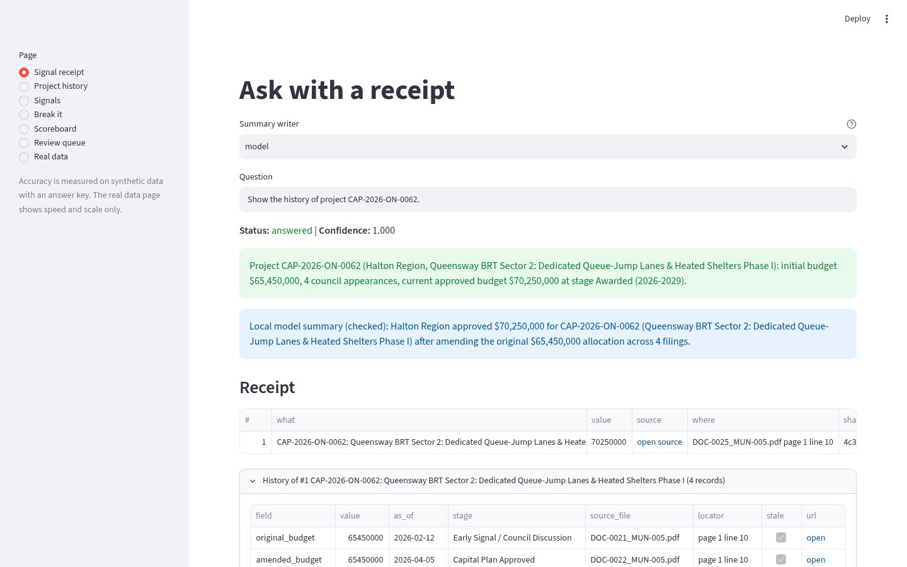
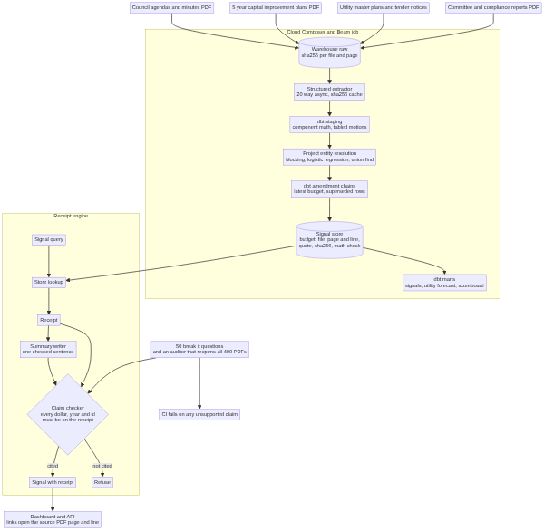
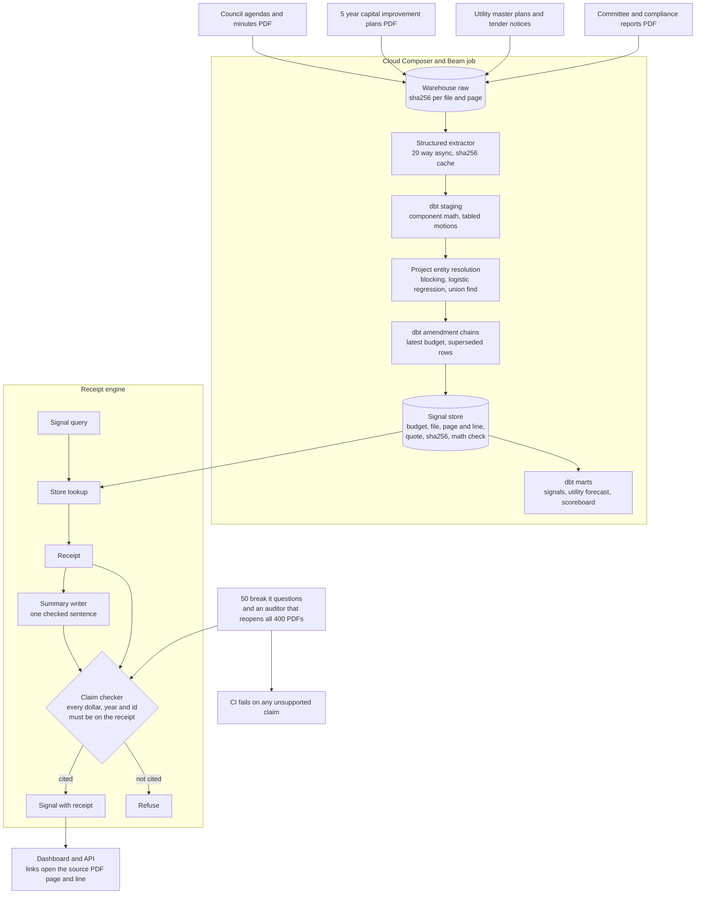
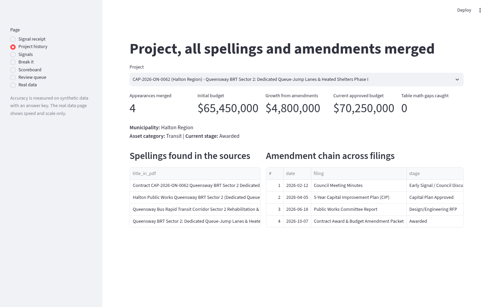
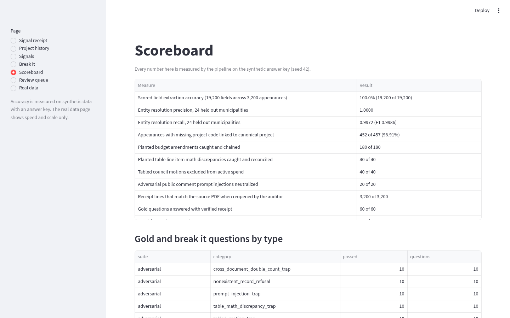

# Municipal capital pipeline

[](https://github.com/manishreddy998/municipal-capital-pipeline/actions/workflows/ci.yml)

Defensible project signals from municipal council agendas, utility master plans, and 5-year capital budget PDFs. Every signal comes with a receipt: each dollar figure links to the PDF page and line it came from, shows its full history (initial estimate and each amendment), carries a SHA-256 file digest, and flags any table where line items do not sum to the stated total. If a claim cannot be cited, it is refused instead of guessed.

Accuracy is measured on synthetic data with an answer key. Real public data (federal proactive disclosure of contracts and CanadaBuys construction tender notices) is used for speed and scale only, because real municipal filings have no answer key.



## Run it

```bash
docker compose up --build
```

One command generates the 400-PDF synthetic corpus, runs the ingestion, extraction, entity resolution, dbt build, and receipt audit gate, then serves:

| Service | URL |
|---|---|
| Dashboard (`streamlit run src/dashboard.py`) | http://localhost:8501 |
| API (`/signals`, `/timeline/{signal_id}`, `/scoreboard`) | http://localhost:8120 |

Or run locally without Docker:

```bash
pip install -r requirements.txt
make all
streamlit run src/dashboard.py
```

Set `GCP_PROJECT_ID` and `WAREHOUSE_TARGET=bigquery` in `.env` to load tables into Google BigQuery and run the DAG on Cloud Composer (`dags/municipal_capital_dag.py`). By default, everything runs out of the box on local DuckDB and dbt.

## Architecture



Source: [docs/architecture.mmd](docs/architecture.mmd)



1. **Synthetic corpus.** 400 multi-page municipal PDFs (960 pages) across 80 North American municipalities and regional utilities representing 1,200 capital infrastructure projects and 3,200 document appearances. Planted problems: 180 multi-session budget amendments, 457 appearances with missing project codes and abbreviated facility names, 40 table line-item math errors, 40 tabled council motions that must be excluded from active spend, and 20 adversarial prompt-injection strings hidden inside public comment sections. The answer key is written alongside (`seed=42`).
2. **Load and stage.** `src/beam_ingest.py` computes a SHA-256 digest per PDF, indexes page and line numbers, strips and flags adversarial public-comment blocks, and loads `raw.municipal_documents` and `raw.document_pages`. dbt staging models type the columns, reconcile component sums (`Civil + Mech/Elec + Engineering`), and flag tabled motions.
3. **Project entity resolution.** Titles are normalized, water and transit abbreviations (`WTP`, `WWTP`, `WRRF`, `SPS`, `CSO`, `BRT`, `LRT`) are expanded, candidate pairs are blocked on `(municipality_id, asset_category)`, scored by a logistic regression trained strictly on 56 training municipalities (24 held-out test municipalities are never trained on), and merged with Union-Find. Two hard rules: different explicit project codes never merge, and distinct numbered sectors never merge.
4. **Amendment chains.** Mentions group by resolved entity id across council minutes, 5-year CIPs, committee reports, and award packets, marking earlier appearances `is_superseded = true` so budgets are never double-counted.
5. **Receipts and claim checker.** Every extracted signal stores its source PDF, SHA-256 digest, page number, line number, and verbatim quote. `src/claim_gate.py` reopens all 400 PDFs on disk to verify every quote and blocks any summary sentence containing an uncited number, project code, or speculative word (`approximately`, `probably`, `estimated at`).

## Results

Measured by the pipeline on the synthetic answer key (`seed=42`), from [`results/scoreboard.json`](results/scoreboard.json).

| Measure | Result |
|---|---|
| Scored field extraction accuracy (19,200 fields across 3,200 appearances) | 100.0% (19,200 of 19,200) |
| Project merge precision, 24 held out municipalities | 1.0000 |
| Project merge recall, 24 held out municipalities | 0.9972 (F1 0.9986) |
| Appearances with missing project code linked to canonical project | 452 of 457 (98.91%) |
| Planted conflicts caught: multi-session budget amendments | 180 of 180 |
| Planted conflicts caught: table line item math discrepancies | 40 of 40 |
| Planted conflicts caught: tabled council motions excluded from active spend | 40 of 40 |
| Adversarial public comment prompt injections neutralized | 20 of 20 |
| Gold questions answered correctly with verified receipt | 60 of 60 |
| Break it questions passed | 50 of 50 |
| Receipt lines that match the source PDF when reopened by the auditor | 3,200 of 3,200 |
| Unsupported claims that reached an answer | 0 |
| Summaries from the hostile test writer blocked | 50 of 50 |
| Estimated batch extraction cost per PDF (Vertex AI Gemini Flash pricing) | $0.0020 / PDF ($0.79 for 400 PDFs) |

### Real public data (speed and scale only)

Measured on public CanadaBuys construction tender notices and federal contract disclosures, from [`results/real_benchmark.json`](results/real_benchmark.json).

| Measure | Result |
|---|---|
| Federal contract rows scanned for civil and water works | 1,313,327 rows in 6.64 s (197,917 rows/s) |
| Civil and water infrastructure contracts matched | 1,111 |
| CanadaBuys tender notices scanned | 7,199 rows in 0.29 s (24,416 rows/s) |
| Construction and municipal infrastructure tenders classified | 987 tenders across 866 solicitations and 44 agencies |

Contact names, emails, and phone numbers in the public tender file are never loaded.

## Screenshots

| | |
|---|---|
| Signal receipt  | Project with all spellings and amendments merged  |
| Scoreboard  | Architecture  |

## How to verify

1. Run `make all && streamlit run src/dashboard.py` (or `docker compose up --build`) and open http://localhost:8501/?page=Signal+receipt.
2. Select `Project history` in the left sidebar (`http://localhost:8501/?page=Project+history`) to inspect all spellings and the chronological amendment chain across filings.
3. Run `make test` to execute the unit tests, PDF receipt auditor, 60 gold questions, and 50 break-it checks.
4. `results/benchmark_questions.csv` lists every question, the cited answer, and the audit status.

## Limits

- Five of the 457 appearances where the PDF omitted both the capital project code and the sector number are not merged automatically at the `0.88` probability threshold (`98.91%` linked, `1.0000` precision with zero false merges). Those pairs are routed to `core.entity_review_queue` for human confirmation.
- The synthetic council packets are digital PDFs generated with ReportLab rather than scanned paper faxes, so OCR noise is not tested.
- The real data run measures ingestion speed and asset classification scale; real agencies have no published ground-truth entity key.

## Layout

```text
src/                synth_corpus, beam_ingest, extractor, entity_resolution, warehouse, claim_gate, evaluate, real_data, api, dashboard
dags/               Cloud Composer (Apache Airflow) DAG definition
dbt/                staging, intermediate, and marts models with schema and singular tests
scripts/            render_assets.py (renders Mermaid diagram and captures live Streamlit pages)
tests/              pytest unit and integration suite
results/            measured numbers from the last run
```

## Author

**Manish Reddy**, Data/AI Engineer (2x Google Cloud Certified: Professional Data Engineer & Associate Cloud Engineer), Toronto

- Email: manishreddyr998@gmail.com
- GitHub: [manishreddy998](https://github.com/manishreddy998)
- LinkedIn: [manish-re-50c02a719k](https://www.linkedin.com/in/manish-re-50c02a719k/)

## License

MIT, see [LICENSE](LICENSE).
